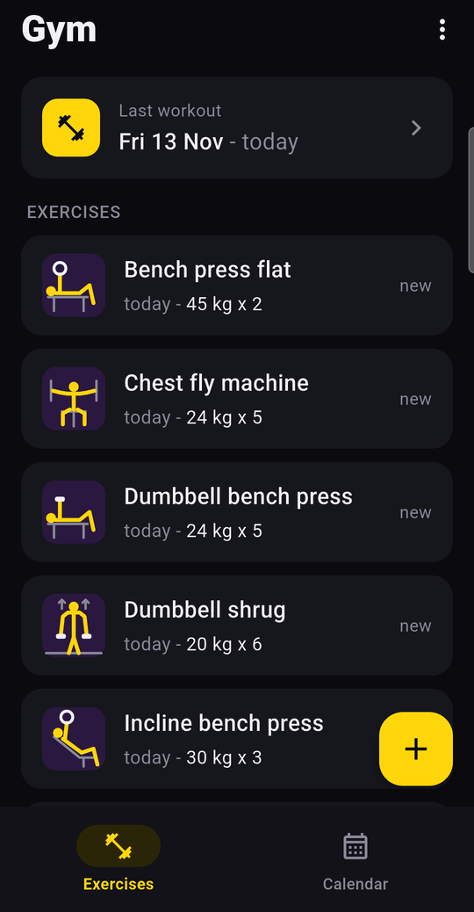
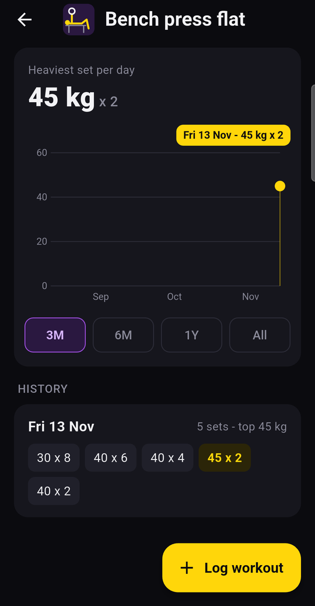
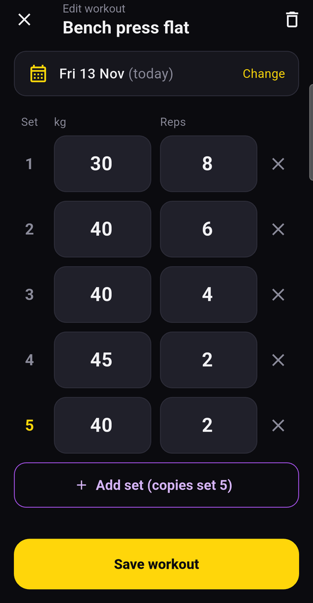
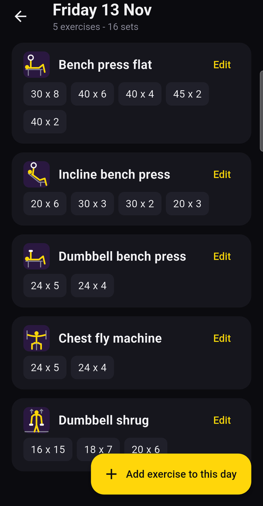
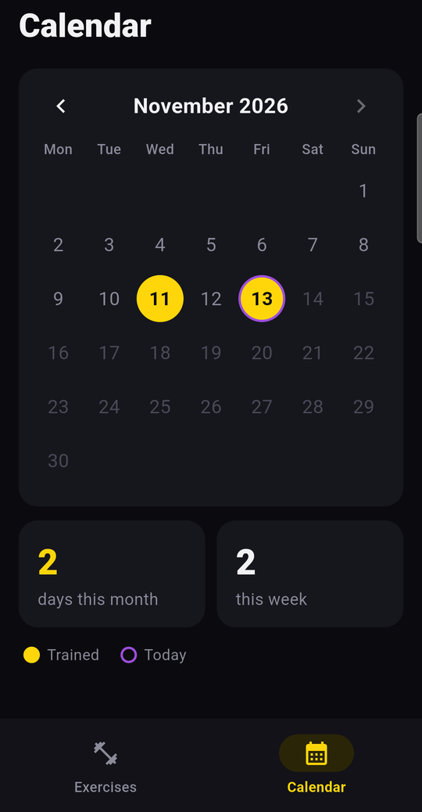
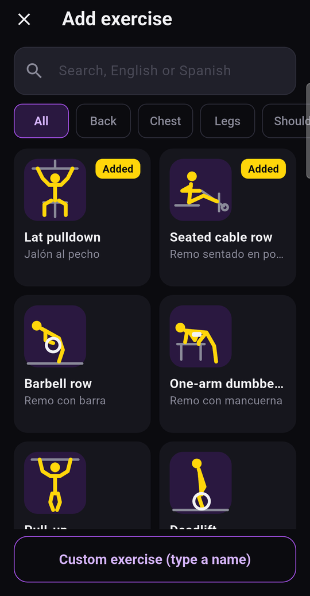

# Gym

A small Android app to log gym workouts and see if you are getting stronger.

- Define your exercises.
- Log each set as kg x reps.
- Per-exercise chart of the weights you lifted over time.
- Calendar marking the days you trained.
- Export everything to CSV.

Dark theme, no account, no ads, no network. Data stays on the phone in a SQLite
database.

Status: in development, see [PLAN.md](PLAN.md).

## Screenshots

| Exercises | Progress chart | Log workout |
|-----------|----------------|-------------|
|  |  |  |

| Day view | Calendar | Exercise catalog |
|----------|----------|------------------|
|  |  |  |

## Build and install

Needs Flutter and the Android SDK.

```
flutter pub get
flutter run --release
```

with your phone connected over USB (or wireless adb). The release build is signed
with your machine's debug key: install updates from the same machine, or Android will
refuse them. Uninstalling deletes your data, so export CSV first.
